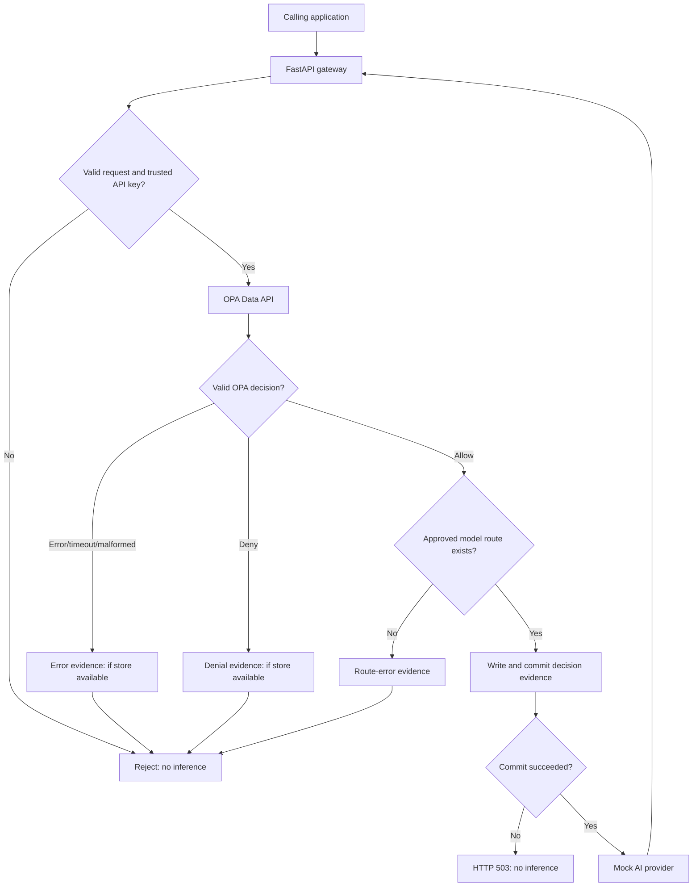

# Architecture — AI Governance & Security Control Plane

**Architecture snapshot:** Day 22 completed (reported 2026-10-29).  
**Scope:** Local developer MVP on macOS with Docker Compose.  
**Status of this document:** Based on the implementation history and reported verification. **Confirm paths, exact function signatures, configuration, and deployed versions against the GitHub repository before treating this as a live inventory.**

## 1. System purpose

The gateway controls which authenticated applications may invoke approved AI models, evaluates OPA/Rego authorization policies, records correlated governance decisions, and **requires committed evidence before approved inference**. The initial provider is deterministic and mocked; a real Ollama adapter is planned for later.

This is a **development-stage control plane**, not a production-certified security or compliance system.

## 2. Current components

| Component | Technology | Responsibility | Status |
| --- | --- | --- | --- |
| Public gateway API | Python, FastAPI, Pydantic | Validate request, authenticate application, orchestrate authorization/evidence/inference, expose liveness endpoint | Implemented |
| Credential verification | HTTP Bearer, SHA-256 digest + constant-time comparison | Accept configured API key and establish trusted application identity | Implemented; static configuration |
| Logical model registry | Python configuration | Identify known models, allowed application/model pairs and approved provider route | Implemented; not yet DB-backed |
| Policy engine | OPA 1.21.4, Rego v1 | Default-deny application/model authorization | Implemented |
| OPA client | HTTPX async | Call OPA Data API with short timeout and strict response validation | Implemented |
| AI provider client | HTTPX async | Forward approved requests to deterministic mock provider | Implemented |
| Governance logging | Python logging, JSON | Correlated, privacy-minimized operational decision events | Implemented |
| Evidence store | Python sqlite3, SQLite | Commit an authorization/evaluation/route record before inference | Implemented; local-only |
| Governance control mapping | Python mapping/catalog | Associate reason codes with internal control identifiers | Implemented |
| Development orchestration | Docker Compose | Gateway, mock-provider and OPA networking | Implemented |
| Verification | pytest, Rego tests, Ruff, GitHub Actions | Unit, integration, enforcement and fail-closed regression | Implemented |

## 3. High-level data flow



The gateway generates a UUID request ID. It is returned through `X-Request-ID` and stored in both the operational policy event and the governance evidence record. The application identity comes from verified server-side authentication, not a caller-controlled header.

**Important:** A successful authorization record does *not* mean the provider completed inference. Provider result events are planned for revised Day 33.

## 4. Runtime request sequence

1. Receive and validate `POST /v1/chat/completions` using Pydantic. Generate a gateway-controlled request ID.
2. Authenticate the caller using the configured Bearer API key; derive an application identity.
3. Evaluate `data.aicp.authz.decision` through the OPA Data API using the trusted application ID and requested logical model ID.
4. Reject invalid, absent, unavailable, contradictory, or disallowing OPA decisions. No provider request is made.
5. For an OPA `allow`, verify a registered, approved destination exists; a policy allow alone cannot invent a route.
6. Construct an `EvidenceRecord` with request ID, application ID, model ID, outcome, reason, policy reference, reported version and mapped control IDs.
7. Execute the SQLite write/transaction. If persistence fails, reject with HTTP 503 and **do not** contact the provider.
8. Log the policy outcome as a JSON event after evidence commit, then forward approved requests through HTTPX.
9. Return the mock response or a mapped provider timeout/error. Evidence is an authorization decision, not a guarantee of provider success.

Requests that fail authentication or input validation before policy evaluation do not yet have an OPA decision-evidence record.

## 5. API and behavior

| Route | Purpose | Notes |
| --- | --- | --- |
| `GET /health/live` | Gateway liveness | Exists from the project foundation. |
| `POST /v1/chat/completions` | Authenticated, authorized chat inference | Main governed path; request and response modeled with Pydantic. |
| `GET /v1/models` | Future model discovery | Planned around Day 54; **not yet implemented**. |
| `GET /v1/controls` | Future control discovery | Planned around Day 54; **not yet implemented**. |
| Admin evidence lookup | Future privileged query API | Planned for revised Day 34; **not yet implemented**. |

Observed/reported denial mappings include 401 missing/invalid key, 403 known but disallowed model, 404 unregistered model, 503 unavailable/invalid policy result, 503 evidence failure, 502 other provider failures, and 504 provider timeout. Any detailed route/status behavior should be checked against the actual code and tests.

## 6. Policy contract

**Logical policy:** `package aicp.authz` / `data.aicp.authz.decision`.

A normal Day 22 decision is expected to look like:

```json
{
  "result": {
    "allow": true,
    "reason": "ALLOW",
    "policy_version": "model-access/v1"
  }
}
```

Expected reason codes:

- `ALLOW`
- `MODEL_NOT_ALLOWED`
- `UNKNOWN_APPLICATION`
- `MODEL_NOT_REGISTERED`

Python also records operational error reasons such as `POLICY_EVALUATION_ERROR` and `ROUTE_UNAVAILABLE`.

**Temporary compatibility limitation:** The Day 22 Python `PolicyDecision` model allows `policy_version` to be absent in older mocked responses and stores `not_reported` in that case. Day 31 integrity work should be coordinated with eventual strict version enforcement; a self-reported version alone does not establish exact loaded-policy provenance.

### Known logical models and application examples

Earlier implementation specified `local-small` and `restricted-small`, routed to `mock-provider`. Application identities used in tests/examples include `demo-app`, `test-app` and `finance-assistant`. The exact effective registry and allowlist must be confirmed in `app/model_registry.py` and the deployed Rego policy before changing them.

## 7. Governance evidence model (current SQLite prototype)

**Implementation files expected:** `app/evidence.py`, `app/governance_controls.py`; database mounted in development Compose under `/tmp/aicp-evidence/evidence.sqlite3`, typically backed by `local-data/evidence/` on the host.

**Table:** `policy_evidence`

| Column | Semantics |
| --- | --- |
| `evidence_id` | UUID-style record identifier / primary key |
| `request_id` | Unique gateway correlation identifier |
| `occurred_at` | UTC timestamp |
| `application_id` | Trusted application identity |
| `model_id` | Requested logical model identifier |
| `outcome` | `allow`, `deny`, or `error` |
| `reason` | Decision or error reason |
| `policy_ref` | Logical policy reference, e.g. `aicp.authz.decision` |
| `policy_version` | Reported version, e.g. `model-access/v1`, or `not_reported` |
| `control_ids` | JSON list of internal control IDs |

The Day 22 migration adds `policy_version` and `control_ids` to an existing Day 20 SQLite table, without relabeling older evidence. Older records retain `not_reported` and `[]`.

The SQLite write is a transactional insert that must successfully return before inference is forwarded. The current implementation is suitable for a low-volume local MVP, not distributed exactly-once processing or tamper-evident storage.

### Current internal controls

| Control ID | Meaning |
| --- | --- |
| `AICP-AC-001` | Application-to-model authorization |
| `AICP-RT-001` | Trusted model routing |
| `AICP-FC-001` | Fail-closed policy evaluation |
| `AICP-EV-001` | Evidence committed before inference |

These are **internal project IDs**, not certified mappings to NIST, ISO, or any regulatory scheme. An event containing a control ID indicates relevance, not independent proof of the control's efficacy.

## 8. Deployment and configuration

**Expected Compose services:**

- `gateway` — built from the local Python application, exposed to the host on `127.0.0.1:8000` for development.
- `mock-provider` — deterministic development provider, reachable within Compose around port `8001`.
- `opa` — OPA 1.21.4, internal port `8181`, loaded with `policies/model_access.rego`, *not* published to the public host interface in normal Compose.

**Configuration keys previously used:**

| Variable | Role | Secret? |
| --- | --- | --- |
| `AICP_API_KEY_SHA256` | Configured API-key digest | Treat as sensitive configuration |
| `AICP_APP_ID` | Authenticated application identity in local MVP | No, but security-relevant |
| `MOCK_PROVIDER_URL` | Approved internal mock provider base URL | No; restrict destinations |
| `OPA_URL` | Internal OPA base URL | No; must be trusted |
| `AICP_EVIDENCE_DB_PATH` | Absolute path for SQLite file | No; data file is sensitive |

Do not commit raw API keys, live `.env` files, database contents, prompts, provider responses, or production credentials. The local `AICP_API_KEY` shell variable is used to send test calls; it is not a server-side configuration secret to commit.

**Security-conscious HTTP behavior reported:** HTTPX uses explicit base URLs, disabled redirects, and `trust_env=False`; short timeouts are configured for OPA and provider requests. The gateway container was configured to run non-root. OPA was configured with a read-only filesystem / limited capabilities in prior development steps. Reconfirm these settings in Compose before relying on them.

## 9. Code map — expected paths

```text
app/
  main.py                 # FastAPI endpoints and enforcement sequence
  auth.py                 # API-key verification and application identity
  model_registry.py       # Logical models, fixed approved routes
  policy_client.py        # Async OPA HTTPX client and Pydantic decision validation
  policy_audit.py         # Structured JSON policy decision logs
  evidence.py             # SQLite evidence record and persistence
  governance_controls.py  # Internal control mapping
  provider_client.py      # HTTPX provider client
  mock_provider.py        # Deterministic mock inference service
policies/
  model_access.rego
policy_tests/
  model_access_test.rego
tests/
  conftest.py
  test_opa_enforcement.py
  test_policy_observability.py
  test_governance_evidence.py
  test_fail_closed_e2e.py
  test_governance_mapping.py
compose.yaml
.github/workflows/         # Continuous integration
```

This is a **historical expected file map**, not a substitute for `git ls-files` against the connected repository.

## 10. Security invariants to preserve

1. No unauthenticated request reaches inference.
2. No denied, missing, malformed, or unavailable OPA decision grants access.
3. No model route is selected directly from untrusted client-supplied provider URLs.
4. No approved inference runs without a successfully committed governance evidence record.
5. Policy and evidence failures do not silently fall back to an allow decision.
6. Policy logs and evidence omit raw keys, Authorization headers, prompts, and model outputs.
7. `X-Request-ID` is generated by the gateway and links response, log and evidence.
8. Authorization approval and inference outcome are recorded as distinct concepts.

When switching SQLite evidence to PostgreSQL (revised Day 29), test invariant 4 explicitly with storage outages and concurrent requests.

## 11. Known limitations / planned architecture changes

- PostgreSQL/SQLAlchemy/Alembic and normalized governance tables: revised Days 23–29.
- Trusted classification-aware policy context and downgrade protection: revised Day 30.
- Pinned source/bundle digest and runtime deployment verification: revised Day 31.
- Separate inference outcome events: revised Day 33.
- Administrator-only decision lookup: revised Day 34.
- Canonical evidence serialization, hash chaining, JSONL exports, offline verifier: Days 36–42.
- Threat model, management-network restrictions, egress controls and security tests: Days 43–49.
- Real Ollama model adapter, discovery endpoints, reproducible demo and release packaging: Days 50–60.

## 12. How to update this document

At the start of each new week, inspect the actual repository and CI. Update the component inventory, schema, environment configuration, trust boundaries and remaining limitations. Record major changes in [`decisions.md`](decisions.md). Never describe a hypothetical capability as already running.
