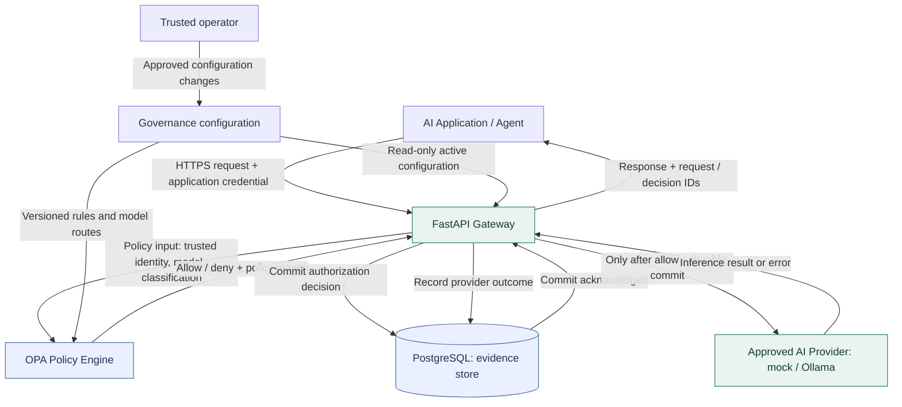
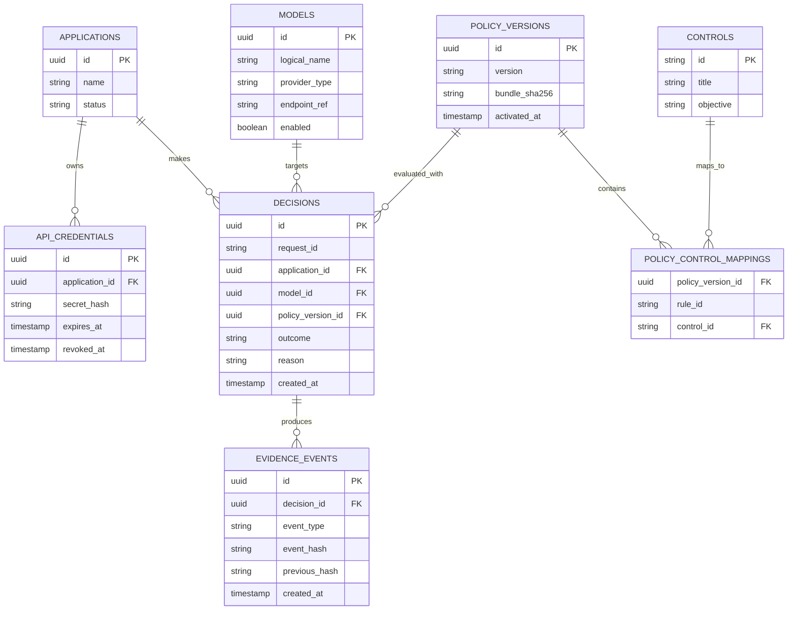

# AI Control Plane — System Architecture

> **Project:** AI Control Plane  
> **Document:** Day 3 architecture and trust-boundary specification  
> **Version:** 0.1 (proposed design)  
> **Status:** Draft — not yet implemented  
> **Primary stack:** Python, FastAPI, Open Policy Agent (OPA), PostgreSQL, Docker Compose  
> **Scope:** Single-organization, self-hosted MVP

## 1. Purpose

AI Control Plane is an open-source system for enforcing security policies on AI inference requests and creating governance evidence that shows **which policy was evaluated, what decision was made, and what happened next**.

The first release aims to prove one end-to-end workflow:

1. An application submits a request to an approved model through the gateway.
2. The gateway authenticates the application and validates the request.
3. OPA evaluates a versioned authorization policy.
4. The gateway durably records the decision and its governance-control references.
5. **Only if the request is allowed and the evidence write succeeds**, the gateway forwards it to an approved inference endpoint.
6. The gateway records the outcome (success, failure, or unknown) and returns a response.

**Non-goal:** The MVP is not a certification tool and does not guarantee compliance with any regulatory framework.

## 2. System context



**Diagram interpretation:** The inference path is controlled by the gateway. PostgreSQL is an evidence store, not an authorization engine. OPA returns authorization decisions, not inference results. The governance configuration is managed by an operator and should not be modified by an AI model or a requesting application.

### 2.1 Two logical planes

- **Runtime/data plane:** Gateway, policy evaluation, provider adapter. Handles requests and enforcement.
- **Governance/control plane:** Policy definitions, model registry, control mappings, audit queries, and evidence export. Governs how the runtime behaves and demonstrates what happened.

For v0.1 these planes may share one deployment, but they have distinct permissions and interfaces. As the project grows, they can be deployed separately without fundamentally changing the request contract.

## 3. Components and responsibilities

| Component | Responsibilities | Must not be permitted to do |
|---|---|---|
| **AI application / agent** | Call the gateway; present credentials; submit request fields | Supply trusted identity; override policy; select arbitrary provider URLs |
| **FastAPI gateway** | Validate credentials and requests; construct trusted policy inputs; enforce decisions; commit evidence; route requests; handle failures | Forward denied requests; silently skip mandatory evidence; use arbitrary caller-selected destinations |
| **OPA** | Evaluate versioned Rego policies using policy input from gateway | Perform inference; modify application identities or evidence |
| **PostgreSQL** | Hold application/model metadata, policy version references, decisions, and outcome events | Act as the policy decision point; accept unauthenticated writes |
| **Model provider adapter** | Call configured mock or Ollama model endpoints; normalize provider errors | Change policy versions, governance controls, or audit history |
| **Trusted operator** | Manage credentials, allowed destinations, policy versions, governance mappings | Quietly bypass policy and evidence requirements without a separately tracked administrative action |

## 4. Scope and assumptions

### 4.1 In scope for MVP v0.1

- One HTTP endpoint compatible with a limited subset of OpenAI-style non-streaming chat completions.
- Application API-key authentication, server-side credential-to-identity mapping, and revocation.
- Approved model registry with fixed provider destinations.
- OPA/Rego authorization for application/model allowlists and data classifications.
- Durable authorization evidence before forwarding allowed requests.
- Separate outcome event after an inference attempt.
- Minimal metadata-only audit retrieval, JSONL export, and integrity verification.
- Integration tests for allow, deny, and dependency failures.
- Docker Compose development environment; mock inference first, optional Ollama afterward.

### 4.2 Explicitly out of scope

- Training or fine-tuning models; high-performance GPU inference.
- Multi-tenant production operation, Kubernetes, service mesh, distributed HA.
- Streaming completions and complex tool/function-call interception.
- Automated detection of every sensitive datum in arbitrary prompts.
- Compliance certification or legal conclusions.
- Tamper-proof evidence without independently protected checkpoints.
- A full graphical governance dashboard.

### 4.3 Deployment assumptions

- The MVP runs locally on a developer Mac or a private Linux machine.
- OPA, PostgreSQL, and model endpoints are accessible only over restricted internal network paths.
- The gateway is the only authorized route from participating applications to protected inference endpoints.
- Administrative and runtime credentials are distinct.
- The trusted operator has more privilege than end-user applications; safeguards for privileged compromise remain a future hardening area.

## 5. Request processing and security sequence

```mermaid
sequenceDiagram
    participant App as Application
    participant GW as FastAPI Gateway
    participant OPA as OPA
    participant DB as PostgreSQL
    participant AI as Approved Model

    App->>GW: POST /v1/chat/completions + API key
    GW->>GW: Authenticate, validate, resolve trusted metadata
    GW->>OPA: Evaluate policy (no prompt text)
    OPA-->>GW: Allow/deny, reason, control references
    alt Denied
        GW->>DB: Commit deny decision
        GW-->>App: 403 policy_denied (if evidence committed)
    else Allowed
        GW->>DB: Commit allow decision
        alt Evidence commit fails
            GW-->>App: 503; do not call model
        else Evidence committed
            GW->>AI: Forward to configured provider
            AI-->>GW: Response, error, or timeout
            GW->>DB: Record outcome event
            GW-->>App: Completion or controlled error
        end
    end
```

**Important operational nuance:** If recording the outcome fails *after* an authorized request reaches the provider, the action cannot be undone. The system must retain/raise an operational alert, avoid claiming complete evidence, and classify an uncertain outcome appropriately. In v0.1, use a durable attempt identifier and document this limitation. The gate guarantees durable **authorization evidence before dispatch**, not a guaranteed post-call outcome record under every failure.

## 6. External interface contracts (proposed)

### 6.1 Runtime API

`POST /v1/chat/completions`

```http
Authorization: Bearer <application-api-key>
Content-Type: application/json
X-Data-Classification: internal
```

```json
{
  "model": "local-small",
  "messages": [{"role": "user", "content": "Summarize the project."}],
  "stream": false
}
```

For v0.1, reject unsupported streaming/tool-call fields explicitly. `application_id` is obtained from the authenticated credential; it is never accepted as a trusted caller-supplied identifier. The classification header is allowed only if it matches policy-approved classifications for the application; do not accept unauthorized downgrades. A classification scheme requiring stronger guarantees needs server-side labels or trusted upstream provenance.

**Response headers** (when a decision was recorded):

```http
X-Request-ID: req_example
X-Policy-Decision-ID: dec_example
```

Example denial body:

```json
{
  "error": {
    "type": "policy_denied",
    "code": "MODEL_NOT_APPROVED",
    "message": "Requested model is not approved for this application.",
    "request_id": "req_example",
    "decision_id": "dec_example"
  }
}
```

### 6.2 OPA API

The gateway sends a structured input to OPA's Data API route `POST /v1/data/aicp/authz/decision`:

```json
{
  "input": {
    "application_id": "finance-assistant",
    "model_id": "local-small",
    "data_classification": "internal",
    "environment": "development"
  }
}
```

Expected response shape:

```json
{
  "result": {
    "allow": true,
    "reason": "APPROVED_ROUTE",
    "control_ids": ["CTRL-001", "CTRL-002"]
  }
}
```

The gateway must validate types and required fields, enforce a timeout, and fail closed if OPA is unavailable, malformed, or missing a decision. Policy bundle version and digest should be obtained from a locally verified configuration snapshot rather than trusted from an unverified client request.

### 6.3 Operational APIs

| Method | Path | Access | Purpose |
|---|---|---|---|
| GET | `/health/live` | Local / infrastructure | Process liveness only |
| GET | `/health/ready` | Restricted infrastructure | OPA and database readiness |
| GET | `/v1/models` | Authorized callers | List available model identifiers (filtered by permissions) |
| GET | `/v1/controls` | Admin | Governance control registry |
| GET | `/v1/decisions` | Admin | Search redacted decision records |
| GET | `/v1/decisions/{id}` | Admin | Retrieve specific redacted decision |
| GET | `/v1/evidence/export` | Admin | Export metadata-only evidence |

### 6.4 Failure status mapping

| Condition | Expected behavior |
|---|---|
| Missing / invalid API key | `401`, no provider call |
| Invalid input or disallowed classification claim | `400`, no provider call |
| Unknown registered model | `404`, no provider call |
| Policy deny | `403` after deny evidence is committed; no provider call |
| OPA unavailable / malformed result | `503`, no provider call |
| Mandatory authorization evidence commit fails | `503`, no provider call |
| Provider unavailable | `502` or `503`; record attempt and best-effort outcome |
| Provider times out after dispatch | Controlled timeout response; mark outcome `unknown` |

When a deny decision cannot be persisted, return `503` rather than pretending a fully audited denial happened.

## 7. Data model (logical)



**Minimal evidence fields:** event ID, request ID, decision ID, authenticated application, model route, trusted classification, allow/deny, reason, control identifiers, policy version and digest, UTC timestamp, and a later outcome status. By default, **do not log prompts, completions, raw credentials, or other unnecessary personal data**.

The initial event chain is best treated as *tamper-evident relative to a trusted checkpoint*, not immutable. A privileged database administrator can potentially rewrite both events and hashes. Future versions may sign and externally anchor chain checkpoints.

## 8. Governance control mapping

| Control ID | Governance objective | Technical enforcement | Evidence |
|---|---|---|---|
| `CTRL-001` | Only authorized applications use approved models | Credential-derived identity + model allowlist | Application, model, allow/deny, policy version |
| `CTRL-002` | Sensitive workloads use approved destinations | Trusted classification + private route restriction | Classification, destination, rule outcome |
| `CTRL-003` | Mandatory authorization actions are auditable | Durable pre-inference decision commit | Event ID, decision ID, committed timestamp |

Framework references may be mapped later (e.g., NIST AI RMF, ISO/IEC 42001, EU AI Act), but those mappings are **informational**, not compliance certification.

## 9. Trust boundaries and threats

| Boundary | Example threat | MVP control | Verification idea |
|---|---|---|---|
| **TB-01:** Application → Gateway | Spoof application ID | Authenticate API key and derive identity server-side | Caller-supplied identity cannot change authorization |
| **TB-02:** Gateway → OPA | Malformed decision or OPA outage | Strict response validation, timeout, fail closed | Kill OPA and verify zero provider calls |
| **TB-03:** Gateway → Database | Audit loss | Transactional durable pre-forward commit | Disable DB and verify zero provider calls |
| **TB-04:** Gateway → Provider | SSRF or unapproved model endpoint | Fixed endpoint registry, network egress restrictions | Reject user-supplied URL / unknown model |
| **TB-05:** Operator → Policy/config | Unauthorized policy edit | Separate administrator credentials; versioned changes | Unauthenticated policy modification rejected |
| **TB-06:** Provider → Gateway/Application | Prompt injection in model output | Treat model output as untrusted data, not administrative instructions | Fake 'ignore policy' output has no control effect |
| **TB-07:** Gateway → Telemetry | Sensitive prompt leakage | Metadata-only structured logging, redaction | Tests assert prompts and credentials absent from logs |
| **TB-08:** Network → Management endpoints | Unauthorized audit access | Bind locally/restrict network, dedicated admin authentication | Unauthenticated export request rejected |

**Security note:** A malicious app can directly call a public cloud API with its own credentials unless deployment/network rules and organizational controls prevent it. The gateway can only guarantee enforcement for participating traffic that is constrained to the protected path.

## 10. Security invariants

These are *testable properties*, not aspirational goals.

1. **No authorization bypass:** No protected inference call is dispatched without a validated application identity and an explicit policy allow result.
2. **Fail closed:** If identity validation, policy evaluation, or mandatory decision persistence fails, the provider call count is zero.
3. **Evidence before execution:** Every dispatched provider request references a previously committed allow decision.
4. **Trusted routing:** Only configured and approved provider destinations may be contacted.
5. **No secret or prompt logging by default:** Credentials and request/response text must not appear in audit events or ordinary telemetry.
6. **Separation of duties:** Model output and application inputs cannot modify policy definitions or erase governance evidence.

## 11. Deployment and isolation plan

In the initial Docker Compose setup:

- Publish the FastAPI development port on `127.0.0.1` only.
- Do not publish OPA, PostgreSQL, or the mock provider to the host unless specifically needed for debugging.
- Separate gateway/provider traffic from management paths through container networks where practical.
- Supply secrets through local environment files excluded from Git; do not bake credentials into images.
- Run as non-root where practical, pin container image versions/digests, and avoid unnecessary privileges.
- Use a mock AI provider for deterministic security tests; enable Ollama only for an optional real-model demonstration.

Your current 16 GB Mac is sufficient to develop this architecture using a mock provider. Dedicated AI GPU hardware is not needed for v0.1.

## 12. Initial security acceptance tests

| Test | Expected result |
|---|---|
| Approved app + approved model | Exactly one provider call; committed allow decision |
| Unknown / revoked credential | `401`; zero provider calls |
| Disallowed model | `403` or `404` according to model visibility; zero provider calls |
| Confidential data + prohibited cloud route | Deny; zero provider calls |
| OPA unavailable | `503`; zero provider calls |
| OPA returns unexpected payload | `503`; zero provider calls |
| Evidence database unavailable | `503`; zero provider calls |
| Attempt to supply arbitrary model endpoint URL | Rejected; zero unauthorized outbound calls |
| Provider timeout after dispatch | Outcome recorded as `unknown` if possible |
| Prompt injection instructs gateway to disable auditing | No change to gateway policies or evidence |
| Sensitive content in prompts | Content absent from default audit and telemetry fields |
| Modified exported evidence event | Integrity verification detects mismatch against trusted checkpoint |

## 13. Implementation order

1. **Day 3 (now):** Commit this architecture, trust boundaries, and security invariants.
2. **Day 4:** Confirm MVP in-scope/out-of-scope features and acceptance criteria.
3. **Week 2:** Build a mock-provider-backed authenticated FastAPI gateway.
4. **Week 3:** Integrate OPA and prove policy allow/deny with fail-closed tests.
5. **Week 4:** Implement PostgreSQL decision records and pre-forward commit gate.
6. **Week 5:** Map policy decisions to governance controls and query records.
7. **Week 6:** Export and integrity-verify evidence with documented limitations.
8. **Week 7:** Threat-model-based attack and failure testing.
9. **Weeks 8–9:** Optional Ollama integration, clean installation, documentation, release.

## 14. Architecture decision records (ADRs)

### ADR-001: Python + FastAPI for the MVP

**Decision:** Implement the runtime gateway and supporting APIs in Python/FastAPI.  
**Why:** Existing Python skills, rapid iteration, strong testing and AI ecosystems.  
**Tradeoff:** Less efficient than some compiled languages at extreme request rates.  
**Revisit when:** Profiling shows that Python request handling—not inference, OPA, or database I/O—is the limiting factor.

### ADR-002: OPA as an external policy decision point

**Decision:** Use OPA/Rego rather than embedding security decisions in arbitrary Python conditional logic.  
**Why:** Policy versioning, independent testing, and clear governance traceability.  
**Tradeoff:** Adds a service dependency and policy lifecycle work.  
**Mitigation:** Fail-closed behavior and pinned, verified policy bundles.

### ADR-003: Durable authorization evidence before provider calls

**Decision:** Commit a minimal decision record before dispatching an allowed inference request.  
**Why:** Governance evidence must describe real enforcement, not a reconstructed claim.  
**Tradeoff:** Database availability is on the critical request path.  
**Mitigation:** Clear `503` failure behavior and short transaction boundaries.

### ADR-004: Mock provider before local model

**Decision:** Use a deterministic mock provider for the first security tests.  
**Why:** Fast, repeatable, GPU-free tests that can reliably prove requests were or were not dispatched.  
**Tradeoff:** Does not validate realistic model performance.  
**Mitigation:** Add an optional Ollama adapter after policy and evidence behavior works.

## 15. Open questions for later iterations

- What is the trusted source of workload data classification for each application?
- How should an operator securely rotate application API keys and activate policy bundles?
- What evidence retention period should an administrator configure?
- How should the system report missing post-inference outcome events after crashes?
- When should the hash chain be externally anchored or signed?
- How should the gateway support streaming without weakening the audit guarantees?

## 16. Day 3 definition of done

- [ ] Architecture diagram committed and visible in GitHub Markdown.
- [ ] Component responsibilities and non-responsibilities documented.
- [ ] At least six trust boundaries described with threats and controls.
- [ ] Three core invariants identified (this document includes six).
- [ ] In-scope and out-of-scope MVP features clearly stated.
- [ ] `docs/architecture.md` reviewed and committed to Git.

---

**Document maintenance:** Revisit this specification when a security control, trust assumption, or architecture component changes. Keep the document aligned with tested behavior; design decisions in this draft are not claims that the controls are already implemented.
